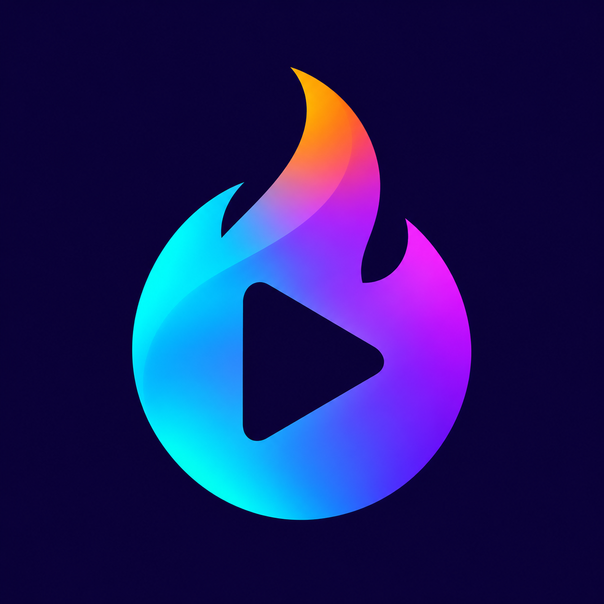

# Streamio4Fire



Experimental, self-contained Stremio client for **Vega OS 2.0 / ARMv7 Fire TV**.
The torrent engine runs on the Stick; playback does not require a laptop server.
This is an independent project, unaffiliated with Stremio or Amazon.

## Current status

Confirmed on a Fire TV Stick HD running Vega OS 2.0:

- Bundled Stremio Web frontend with a local Rust streaming engine.
- Real Torrentio selection and progressive playback of licensed Big Buck Bunny.
- Video, audio, pause/resume, Back, seeking and D-pad control navigation.
- Settings → Streaming & Cache: persistent Auto/manual budget, storage usage,
  clearing unused downloads, and idle download pausing.
- Addon installation links return to the app instead of a blank WebView.
- Startup loading indicator and a 20-second timeout with a remote-focusable
  Retry button; retry recreates the WebView without clearing app data.

**Auto defaults to a maximum 1.5 GiB rolling-cache budget.** Settings allows
manual budgets from 0.5–8 GiB, limited by available storage with 384 MiB reserved
for the system. Reductions protect active downloads and reclaim idle entries.
Preferences survive app restarts and clearing unused cache.
The desired 4GB Torrentio filter is preserved. Files can exceed the cache budget:
older pieces are discarded and fetched again when seeking backwards. The engine
downloads playback windows instead of retaining the complete movie. A synthetic
torrent over 4 GiB passed byte-verified streaming and seeks with an 8 MiB cache on
both the development host and the ARMv7 Stick.
Launcher visibility and long-running playback also need further device testing.
This repository contains development source, not a finished consumer release.

In the app, open **Settings**, then select **Streaming & Cache** at the bottom
right. Choose Auto or an available manual budget and press Save. This budget is
independent of Torrentio's source-size filter. Clear unused cache preserves active
downloads. The Back button closes the settings dialog.

## Layout

| Path | Purpose |
| --- | --- |
| `torrent-probe/src` | Rust engine, Stremio HTTP adapter, ranges and cache management |
| `torrent-probe/vega-module` | C++ / TypeScript bridge into the Rust library |
| `torrent-probe/stremio-wrapper` | React Native / TypeScript Vega WebView app |
| `torrent-probe/frontend-controls` | Frontend keyboard patch and TV controls |
| `scripts/build.sh` | Build the pinned frontend, native module and application |

Historical internal names such as `VegaTransport` and the diagnostics package ID
are retained to avoid breaking the native bridge or existing device app data.
The display name is **Streamio4Fire**.

## Building

Use Linux or WSL with the Amazon Vega SDK configured, Node.js 22+, Git, Python 3,
and Rust with the `armv7-unknown-linux-gnueabihf` target. The prototype was built
with Vega CLI 1.4.8 and SDK 2.0.13986. Amazon SDK dependencies require the SDK's
package registry configuration; an ordinary public npm installation is insufficient.

```bash
source ~/vega/env
source ~/.cargo/env
rustup target add armv7-unknown-linux-gnueabihf
# Your SDK/native build directory containing toolchain/ and sysroot-armv7-release/:
export VEGA_SDK_PRIVATE=/path/to/native/build/private
bash scripts/build.sh
```

The script downloads the official Stremio Web source at the pinned commit,
preserves its licence, applies our keyboard patch, and builds its assets locally.
It also builds a checksum-pinned FFmpeg subset into the native module for
[standalone MKV seeking](docs/mkv-seeking.md), without re-encoding media.
Website service-worker registration is disabled: these assets are already bundled
with the native app. The entry page uses `/app/`, outside the legacy `/upnp/ui/`
worker scope, while keeping the same origin and existing user data.
SDKs, dependencies, compiled assets and installers are excluded from Git.
The complete build from this newly assembled checkout still needs validation;
individual components and the installed prototype were tested during development.

Install the resulting `torrent-probe/stremio-wrapper/build/armv7-release/*.vpkg`
using the Vega SDK device tools. Enable developer access and supply your device
address locally. No accounts, VPN credentials or configured addons are included.
Installable packages use Release mode. Debug mode enables development services
and showed unbounded resolver-thread growth on the retail Stick during
[testing](docs/validation/2026-11-09-release-playback.md).

## Checks

```bash
cd torrent-probe
cargo test --locked --lib
node frontend-controls/navigation.test.cjs
cd stremio-wrapper
node addonLinks.test.cjs
npx --no-install tsc --noEmit
npx --no-install jest --config jest.startup.config.json --runInBand
```

The TypeScript checks require installed SDK/npm dependencies. The build script
also runs the frontend keyboard tests against the patched upstream source.
The Big Buck Bunny fixture is for freely licensed playback testing.

## Attribution and licensing

See [THIRD_PARTY_NOTICES.md](THIRD_PARTY_NOTICES.md). Upstream licences remain
applicable to their respective code. No project-wide licence has been selected
for the newly written integration code yet. No compiled release is published here.

Rolling-cache design and validation: [docs/rolling-cache.md](docs/rolling-cache.md).
